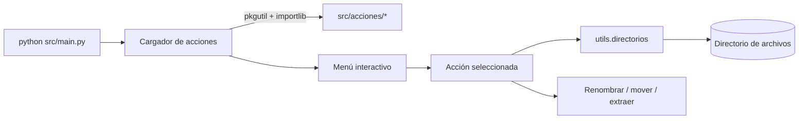

# OrdenaArchivos


Herramienta CLI desarrollada en **Python** para organizar y renombrar archivos de forma masiva dentro de un directorio. Reúne en un solo menú interactivo acciones para normalizar nombres, reemplazar texto, agrupar archivos en carpetas, detectar duplicados, extraer texto y renombrar imágenes, videos y música a partir de sus datos.

El objetivo del proyecto es automatizar tareas de mantención de archivos que suelen hacerse a mano, aplicando una arquitectura de plugins que permite agregar nuevas acciones sin modificar el punto de entrada.

---

## Características

- Menú interactivo que descubre las acciones disponibles de forma automática.
- Arquitectura de plugins: cada acción es un módulo independiente y ejecutable por separado.
- Validación reutilizable del directorio antes de procesar.
- Protección contra colisiones: nunca sobrescribe archivos existentes.
- Procesamiento por lotes y trabajo con rutas absolutas mediante `pathlib`.
- Extracción de texto con detección de archivos binarios y soporte UTF-8/latin-1.
- Detección de videos duplicados mediante hash perceptual del primer frame.
- Renombrado de música a partir de sus etiquetas ID3.
- Ejecución multiplataforma (Windows, Linux y macOS).

---

## Stack tecnológico

| Tecnología | Uso |
|---|---|
| Python 3.10+ | Lenguaje y ejecución de la CLI |
| `pathlib` / `shutil` | Manipulación de rutas y archivos |
| OpenCV (`opencv-python`) | Lectura del primer frame de los videos |
| Pillow | Conversión de frames a imágenes |
| ImageHash | Hash perceptual para detectar videos repetidos |
| Mutagen | Lectura de metadatos ID3 de archivos MP3 |
| Black | Formato consistente del código |
| Pylint | Análisis estático (configurado en `.pylintrc`) |

---

## Arquitectura

El proyecto utiliza una arquitectura de **plugins**. `src/main.py` escanea el paquete `acciones/` con `pkgutil`, importa cada módulo y registra aquellos que exponen una función `ejecutar(rutadirectorio)`.



### Responsabilidades

| Componente | Responsabilidad |
|---|---|
| `src/main.py` | Punto de entrada. Carga las acciones, muestra el menú y delega la ejecución. |
| `src/acciones/` | Paquete de plugins. Cada módulo implementa una acción concreta y expone `ejecutar(rutadirectorio)`. |
| `src/utils/directorios.py` | Validación reutilizable del directorio (`validar_directorio` / `pedir_directorio`). |

### Flujo de ejecución

```text
python src/main.py
        │
        ▼
cargar_acciones()  ──►  pkgutil.iter_modules(acciones)
        │
        ▼
mostrar_menu()  ──►  pedir_directorio()  ──►  validar_directorio()
        │
        ▼
accion.ejecutar(directorio)
        │
        ▼
renombrar / mover / extraer texto
```

1. `main.py` registra las acciones disponibles y arma el menú.
2. El usuario elige una opción e ingresa un directorio válido.
3. La acción seleccionada recorre los archivos y aplica su lógica.
4. Cada acción puede ejecutarse también de forma directa, sin pasar por el menú.

---

## Acciones disponibles

| Acción | Descripción |
|---|---|
| `normaliza_nombre_archivos` | Cambia el estilo de los nombres: minúsculas, MAYÚSCULAS, camelCase, PascalCase, snake_case, kebab-case, Sentence case o Title Case. |
| `reemplaza_nombre_archivos` | Reemplaza un texto por otro en los nombres de los archivos. |
| `separa_archivos_carpetas` | Agrupa los archivos en carpetas de N archivos, nombradas con timestamp. |
| `obtiene_texto_archivos` | Extrae el contenido de los archivos a un `output.txt`, omitiendo binarios. |
| `renombra_imagenes_fecha` | Renombra imágenes a `YYYYMMDD_hhmmss.ext` usando la fecha más antigua del archivo. |
| `renombra_videos_repetidos` | Detecta videos duplicados comparando el hash perceptual del primer frame y antepone `_repeat_YYYYMMDDHHMMSSmmm_<n>_` a todos los archivos del grupo. |
| `renombra_musica_metadata` | Renombra MP3 agregando al nombre los tags título, artista, año y género. |
| `renombra_archivos_carpeta` | Agrega el nombre de la carpeta contenedora como prefijo a cada archivo, de forma recursiva e idempotente. |

### Detalles relevantes

- **Colisiones:** al renombrar o mover archivos se verifica que el nombre destino no exista; de ser necesario se agrega un contador (`_1`, `_2`, ...).
- **Imágenes:** se consideran las extensiones `.jpg`, `.jpeg`, `.png`, `.gif`, `.bmp`, `.webp`, `.tiff`, `.tif` y `.heic`.
- **Videos:** se consideran las extensiones `.mp4`, `.avi`, `.mkv` y `.mov`. Los grupos duplicados se marcan con `_repeat_YYYYMMDDHHMMSSmmm_<n>_` conservando el nombre original; el índice sigue el orden por tamaño descendente y los archivos ya marcados con `_repeat_` se omiten.
- **Música:** los archivos que fallan al procesarse se marcan con el prefijo `_error_` y se registran en `errores.txt`.
- **Prefijo por carpeta:** el nombre de la carpeta se limpia a minúsculas, se eliminan caracteres inválidos y se reemplazan espacios por `_`. Si el nombre queda vacío se usa `sin_nombre`. Los archivos que ya tienen el prefijo se omiten para evitar duplicarlo en ejecuciones sucesivas.
- **Texto:** si un archivo no se puede leer como UTF-8 se intenta con latin-1; los archivos con bytes nulos se omiten.

---

## Estructura del repositorio

```text
ordenaarchivos/
├── src/
│   ├── main.py                            # Punto de entrada (menú)
│   ├── acciones/                          # Plugins de acciones
│   │   ├── __init__.py
│   │   ├── normaliza_nombre_archivos.py
│   │   ├── reemplaza_nombre_archivos.py
│   │   ├── separa_archivos_carpetas.py
│   │   ├── obtiene_texto_archivos.py
│   │   ├── renombra_imagenes_fecha.py
│   │   ├── renombra_videos_repetidos.py
│   │   ├── renombra_musica_metadata.py
│   │   └── renombra_archivos_carpeta.py
│   └── utils/
│       ├── __init__.py
│       └── directorios.py                 # Validación del directorio
├── .gitignore
├── .pylintrc
├── requirements.txt
└── Readme.md
```

---

## Puesta en marcha

### Requisitos

- [Python](https://www.python.org/downloads/) 3.10 o superior (probado con 3.13).
- `pip` actualizado.

### 1. Clonar el repositorio

```bash
git clone https://github.com/ericmunozdev/ordenaarchivos.git
cd ordenaarchivos
```

### 2. Crear y activar el entorno virtual

```bash
python -m venv venv
```

**Windows**

```powershell
.\venv\Scripts\activate
```

**Linux / macOS**

```bash
source venv/bin/activate
```

Para salir del entorno virtual:

```bash
deactivate
```

### 3. Instalar dependencias

```bash
python -m pip install --upgrade pip
pip install -r requirements.txt
```

> `requirements.txt` está guardado en **UTF-8**.

### 4. Ejecutar

```bash
python src/main.py
```

---

## Uso

### Modo menú (recomendado)

```bash
python src/main.py
```

El programa muestra las acciones disponibles, solicita una opción y luego pide el directorio a procesar. La ruta se valida antes de ejecutar cualquier cambio.

```text
Seleccione una acción:

1. normaliza_nombre_archivos
2. reemplaza_nombre_archivos
3. separa_archivos_carpetas
...

Opción: 1
Ingrese el directorio: C:\ruta\a\procesar
```

### Modo directo

Cada acción puede ejecutarse de forma independiente:

```bash
python src/acciones/normaliza_nombre_archivos.py
```

En este modo la acción solicita el directorio por consola y agrega `src/` a `sys.path` para importar `utils.directorios`.

> **Importante:** las acciones renombran y mueven archivos de forma permanente. Prueba primero sobre una copia del directorio.

---

## Desarrollo

> Ejecuta todos los comandos con el entorno virtual `venv` activado.

### Formato y análisis estático

```bash
python -m pip install black pylint
black src/
pylint src/
```

### Gestión de dependencias

Listar los paquetes instalados:

```bash
pip list
```

Listar los paquetes desactualizados:

```bash
pip list --outdated
```

Generar o actualizar `requirements.txt` desde el entorno virtual:

```bash
pip freeze > requirements.txt
```

> En PowerShell el operador `>` guarda en UTF-16. Para forzar UTF-8 de forma explícita:
> `pip freeze | Set-Content -Encoding utf8 requirements.txt`

> Mantén `requirements.txt` en UTF-8: en PowerShell 5.1 usa `Set-Content -Encoding utf8` en lugar de `>` para no generar UTF-16.

### Pruebas

Esquema previsto (aún no hay casos de prueba):

```bash
python -m pip install pytest
python -m pytest -v
```

Alternativa con la biblioteca estándar, sin dependencias extra:

```bash
python -m unittest discover -v
```

> Por convención, los tests se ubicarán en `tests/`. Mientras no existan, los comandos terminan sin ejecutar casos.

---

## Decisiones de diseño

- **Plugins auto-registrados:** agregar una acción consiste en crear un módulo en `acciones/` con una función `ejecutar`; el menú se actualiza solo.
- **Acciones independientes:** cada módulo es ejecutable por separado, lo que facilita probar una acción sin cargar el menú completo.
- **Validación centralizada:** la comprobación del directorio vive en `utils/directorios.py` y es compartida por todas las acciones.
- **Sin `os.chdir`:** se trabaja con `pathlib.Path` y rutas absolutas para evitar estado global compartido.
- **Operaciones seguras:** se controlan los nombres ocupados antes de renombrar o mover, evitando sobrescribir archivos.
- **Separación de responsabilidades:** el menú orquesta, las acciones procesan y las utilidades validan.

---

## Convenciones del código

- **Docstrings** en módulos y funciones públicas.
- **snake_case** para módulos, funciones y variables.
- **Black** como formateador oficial.
- Cada acción expone `ejecutar(rutadirectorio)` y puede ejecutarse con `python src/acciones/<accion>.py`.
- Mensajes de consola en español y errores informados sin interrumpir el procesamiento del resto de los archivos.

---

## Estado del proyecto

- [x] Menú interactivo con carga dinámica de acciones.
- [x] Validación reutilizable del directorio.
- [x] Normalización de nombres con múltiples formatos.
- [x] Reemplazo de texto en nombres de archivos.
- [x] Separación de archivos en carpetas por lotes.
- [x] Extracción de texto a `output.txt`.
- [x] Renombrado de imágenes por fecha.
- [x] Detección de videos repetidos por hash perceptual.
- [x] Renombrado de música por metadatos.
- [x] Renombrado de archivos con prefijo de carpeta.
- [ ] Pruebas automatizadas.
- [ ] Modo simulación (*dry run*) para previsualizar cambios.
- [ ] Registro de operaciones y opción de deshacer.
- [ ] Empaquetado como CLI instalable (`pipx` / `pyproject.toml`).
